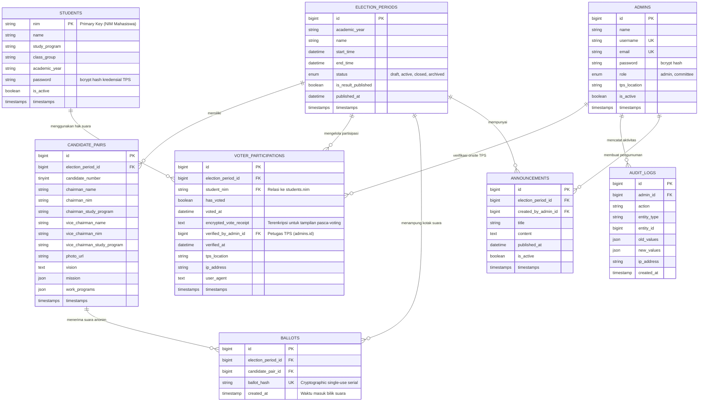

# DATABASE ARCHITECTURE & ENTITY RELATIONSHIP DIAGRAM (ERD)
**Sistem E-Voting PEMIRA BEM Universitas BSI Karawang**
*Dokumen Rancangan Basis Data & Arsitektur Kerahasiaan Suara Anonim*
*(Revisi: Pemisahan Tabel Admin vs Mahasiswa, Primary Key NIM)*

---

## 1. PRINSIP PERANCANGAN BASIS DATA

1. **Pemisahan Tabel Admin vs Mahasiswa (Multi-Table Authentication)**:
   - **Tabel `admins`**: Khusus akun petugas (Super Admin & Panitia TPS). Menggunakan primary key `id` (bigint auto-increment).
   - **Tabel `students`**: Khusus data pemilih Mahasiswa DPT UBSI Karawang. Menggunakan **Primary Key `nim` (string/varchar 20)**.
2. **Multi-Period Archiving**:
   Setiap periode pemilihan (misal: 2026/2027, 2027/2028) berdiri sendiri. Data lampau tetap diarsipkan secara utuh tanpa pernah di-truncate atau dihapus saat memulai pemilihan baru.
3. **Pemisahan Partisipasi dan Kotak Suara (Anonymous Ballot Architecture)**:
   - Dilarang menyimpan `student_nim` dan `candidate_pair_id` dalam satu baris tabel kotak suara (`ballots`).
   - Rekapitulasi dan penghitungan suara **hanya membaca tabel `ballots`**.
   - Hak pilih yang telah digunakan dicatat di `voter_participations` dengan relasi `student_nim` dan constraint unik `(election_period_id, student_nim)`.
4. **Mekanisme Tanda Terima Terenkripsi (Encrypted Receipt)**:
   - Pilihan paslon disimpan dalam format string terenkripsi (`Crypt::encryptString`) pada tabel partisipasi pemilih. Saat mahasiswa login kembali, sistem dapat menampilkan status suara dan paslon yang dipilih tanpa menghubungkan identitas dengan baris surat suara di tabel `ballots`.
5. **Atomisitas Transaksi & Pencegahan Race Condition**:
   - Transaksi pencoblosan dibungkus dalam `DB::transaction` dengan `lockForUpdate` pada record partisipasi pemilih.

---

## 2. DIAGRAM RELASI ENTITAS (MERMAID ERD)



---

## 3. SPESIFIKASI TABEL, INDEX & CONSTRAINT

### 1. `students` (Tabel Pemilih DPT Mahasiswa)
- **Primary Key**: `nim` (VARCHAR(20), string non-incrementing)
- **Kolom**:
  - `nim`: varchar(20) PK
  - `name`: varchar(255)
  - `study_program`: varchar(100) (Prodi di UBSI Karawang)
  - `class_group`: varchar(50) (Kelas)
  - `academic_year`: varchar(10) (Angkatan)
  - `password`: varchar(255) (Bcrypt hash)
  - `is_active`: boolean default true
  - `timestamps`
- **Index**: `study_program`, `class_group`

### 2. `admins` (Tabel Akun Petugas — Admin & Panitia TPS)
- **Primary Key**: `id` (BIGINT UNSIGNED AUTO_INCREMENT)
- **Kolom**:
  - `id`: bigint unsigned PK
  - `name`: varchar(255)
  - `username`: varchar(100) UNIQUE
  - `email`: varchar(255) UNIQUE NULL
  - `password`: varchar(255) (Bcrypt hash)
  - `role`: enum ('admin', 'committee')
  - `tps_location`: varchar(100) NULL (Lokasi bilik/TPS penugasan)
  - `is_active`: boolean default true
  - `timestamps`
- **Index**: `role`, `is_active`

### 3. `election_periods`
- **Primary Key**: `id`
- **Index**: `status`, `start_time`, `end_time`
- **Aturan**: Hanya boleh ada 1 periode berstatus `active` dalam satu waktu.

### 4. `candidate_pairs`
- **Primary Key**: `id`
- **Foreign Key**: `election_period_id` REFERENCES `election_periods(id)` ON DELETE RESTRICT
- **Unique Constraint**: `(election_period_id, candidate_number)` (Nomor urut paslon unik per periode)

### 5. `voter_participations`
- **Primary Key**: `id`
- **Foreign Keys**:
  - `election_period_id` REFERENCES `election_periods(id)` ON DELETE RESTRICT
  - `student_nim` REFERENCES `students(nim)` ON UPDATE CASCADE ON DELETE RESTRICT
  - `verified_by_admin_id` REFERENCES `admins(id)` ON DELETE SET NULL
- **Unique Constraint**: `(election_period_id, student_nim)` **[KUNCI KEAMANAN: 1 NIM HANYA 1 KALI VOTING PER PERIODE]**
- **Kolom `encrypted_vote_receipt`**: Menyimpan `Crypt::encryptString($candidatePairId)` agar mahasiswa dapat melihat kembali paslon pilihannya secara aman tanpa mengekspos kotak suara `ballots`.

### 6. `ballots` (Kotak Suara Anonim Murni)
- **Primary Key**: `id`
- **Foreign Keys**:
  - `election_period_id` REFERENCES `election_periods(id)` ON DELETE RESTRICT
  - `candidate_pair_id` REFERENCES `candidate_pairs(id)` ON DELETE RESTRICT
- **Unique Constraint**: `ballot_hash` (Serial acak unik per lembar surat suara)
- **PRINSIP PRIVASI**: **DILARANG KERAS MEMASUKKAN KOLOM `student_nim` ATAU IDENTITAS MAHASISWA**.

### 7. `audit_logs`
- **Primary Key**: `id`
- **Foreign Key**: `admin_id` REFERENCES `admins(id)` ON DELETE SET NULL
- **Index**: `action`, `created_at`

### 8. `announcements`
- **Primary Key**: `id`
- **Foreign Keys**:
  - `election_period_id` REFERENCES `election_periods(id)` ON DELETE RESTRICT
  - `created_by_admin_id` REFERENCES `admins(id)` ON DELETE CASCADE

---

## 4. ATOMISITAS TRANSAKSI VOTING (`VotingEngineService`)

```php
DB::transaction(function () use ($studentNim, $electionPeriodId, $candidatePairId, $request) {
    // 1. Lock record partisipasi pemilih dengan NIM untuk mencegah race condition (klik ganda simultan)
    $participation = VoterParticipation::where('election_period_id', $electionPeriodId)
        ->where('student_nim', $studentNim)
        ->lockForUpdate()
        ->firstOrFail();

    // 2. Verifikasi hak suara belum digunakan
    if ($participation->has_voted) {
        throw new AlreadyVotedException('Hak suara Anda telah digunakan sebelumnya.');
    }

    // 3. Masukkan surat suara anonim ke tabel ballots (KOTAK SUARA MURNI TANPA NIM)
    Ballot::create([
        'election_period_id' => $electionPeriodId,
        'candidate_pair_id' => $candidatePairId,
        'ballot_hash' => hash('sha256', Str::uuid() . config('app.key')),
        'created_at' => now(),
    ]);

    // 4. Update status partisipasi mahasiswa dan simpan tanda terima terenkripsi
    $participation->update([
        'has_voted' => true,
        'voted_at' => now(),
        'encrypted_vote_receipt' => Crypt::encryptString((string) $candidatePairId),
        'ip_address' => $request->ip(),
        'user_agent' => $request->userAgent(),
    ]);
});
```
