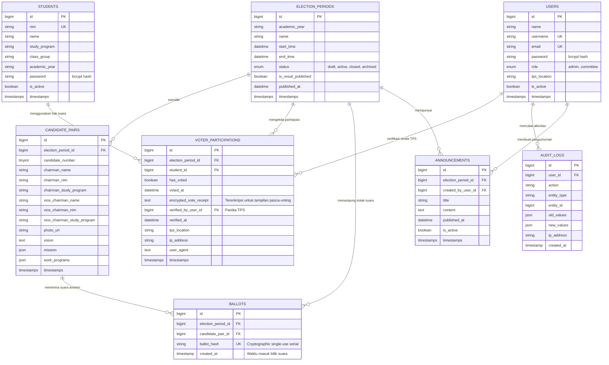

# DATABASE ARCHITECTURE & ENTITY RELATIONSHIP DIAGRAM (ERD)
**Sistem E-Voting PEMIRA BEM Universitas BSI Karawang**
*Dokumen Rancangan Basis Data & Arsitektur Kerahasiaan Suara Anonim*

---

## 1. PRINSIP PERANCANGAN BASIS DATA

1. **Multi-Period Archiving**:
   Setiap periode pemilihan (misal: 2026/2027, 2027/2028) berdiri sendiri. Data lampau tetap diarsipkan secara utuh tanpa pernah di-truncate atau dihapus saat memulai pemilihan baru.
2. **Pemisahan Partisipasi dan Kotak Suara (Anonymous Ballot Architecture)**:
   - Dilarang menyimpan `student_id` dan `candidate_pair_id` dalam satu baris tabel kotak suara (`ballots`).
   - Rekapitulasi dan penghitungan suara **hanya membaca tabel `ballots`**.
   - Hak pilih yang telah digunakan dicatat di `voter_participations` dengan constraint unik `(election_period_id, student_id)`.
3. **Mekanisme Tanda Terima Terenkripsi (Encrypted Receipt)**:
   - Untuk memenuhi kebutuhan *"jika mahasiswa login kembali, menampilkan status bahwa hak pilih telah digunakan dan hanya kandidat yang dipilih yang ditampilkan"*, pilihan paslon dienkripsi secara asimetris/kriptografis (`Crypt::encryptString`) pada tabel partisipasi terpisah, sehingga tidak ada foreign key atau relasi langsung ke baris surat suara anonim di tabel `ballots`.
4. **Atomisitas Transaksi & Pencegahan Race Condition**:
   - Transaksi pencoblosan dibungkus dalam `DB::transaction` dengan `lockForUpdate` pada record partisipasi pemilih.

---

## 2. DIAGRAM RELASI ENTITAS (MERMAID ERD)



---

## 3. SPESIFIKASI TABEL, INDEX & CONSTRAINT

### 1. `election_periods`
- **Primary Key**: `id`
- **Index**: `status`, `start_time`, `end_time`
- **Catatan**: Status `active` hanya boleh ada maksimal 1 periode dalam satu waktu (divalidasi oleh Business Logic / Rule).

### 2. `students`
- **Primary Key**: `id`
- **Unique Constraint**: `nim` (NIM mahasiswa UBSI Karawang bersifat unik global)
- **Index**: `study_program`, `class_group`

### 3. `candidate_pairs`
- **Primary Key**: `id`
- **Foreign Key**: `election_period_id` REFERENCES `election_periods(id)` ON DELETE RESTRICT
- **Unique Constraint**: `(election_period_id, candidate_number)` (Nomor urut tidak boleh kembar dalam satu periode)

### 4. `voter_participations`
- **Primary Key**: `id`
- **Foreign Keys**:
  - `election_period_id` REFERENCES `election_periods(id)` ON DELETE RESTRICT
  - `student_id` REFERENCES `students(id)` ON DELETE RESTRICT
  - `verified_by_user_id` REFERENCES `users(id)` ON DELETE SET NULL
- **Unique Constraint**: `(election_period_id, student_id)` **[KUNCI KEAMANAN 1 NIM 1 SUARA]**
- **Kolom `encrypted_vote_receipt`**: Menyimpan token terenkripsi `Crypt::encryptString($candidate_pair_id)` sehingga saat mahasiswa login kembali, sistem dapat menampilkan paslon yang dipilih tanpa menggabungkan tabel identitas pemilih ke kotak suara `ballots`.

### 5. `ballots` (Kotak Suara Anonim)
- **Primary Key**: `id`
- **Foreign Keys**:
  - `election_period_id` REFERENCES `election_periods(id)` ON DELETE RESTRICT
  - `candidate_pair_id` REFERENCES `candidate_pairs(id)` ON DELETE RESTRICT
- **Unique Constraint**: `ballot_hash` (Serial acak acak unik per lembar surat suara)
- **ATURAN KERAS**: **TIDAK ADA KOLOM `student_id` ATAU FOREIGN KEY IDENTITAS MAHASISWA**.

### 6. `users`
- **Primary Key**: `id`
- **Unique Constraint**: `username`, `email`
- **Index**: `role`, `is_active`

### 7. `audit_logs`
- **Primary Key**: `id`
- **Foreign Key**: `user_id` REFERENCES `users(id)` ON DELETE SET NULL
- **Index**: `action`, `created_at`

### 8. `announcements`
- **Primary Key**: `id`
- **Foreign Keys**:
  - `election_period_id` REFERENCES `election_periods(id)` ON DELETE RESTRICT
  - `created_by_user_id` REFERENCES `users(id)` ON DELETE CASCADE
- **Index**: `published_at`, `is_active`

---

## 4. ATOMISITAS TRANSAKSI VOTING (`VotingEngineService`)

```php
DB::transaction(function () use ($studentId, $electionPeriodId, $candidatePairId, $request) {
    // 1. Lock record partisipasi pemilih untuk mencegah race condition (klik ganda simultan)
    $participation = VoterParticipation::where('election_period_id', $electionPeriodId)
        ->where('student_id', $studentId)
        ->lockForUpdate()
        ->firstOrFail();

    // 2. Verifikasi hak suara belum digunakan
    if ($participation->has_voted) {
        throw new AlreadyVotedException('Hak suara Anda telah digunakan sebelumnya.');
    }

    // 3. Masukkan surat suara anonim ke tabel ballots
    Ballot::create([
        'election_period_id' => $electionPeriodId,
        'candidate_pair_id' => $candidatePairId,
        'ballot_hash' => hash('sha256', Str::uuid() . config('app.key')),
        'created_at' => now(),
    ]);

    // 4. Update status partisipasi mahasiswa dan simpan encrypted receipt
    $participation->update([
        'has_voted' => true,
        'voted_at' => now(),
        'encrypted_vote_receipt' => Crypt::encryptString((string) $candidatePairId),
        'ip_address' => $request->ip(),
        'user_agent' => $request->userAgent(),
    ]);
});
```

